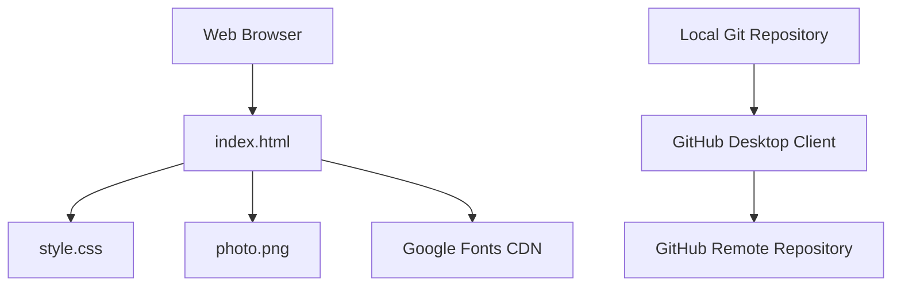

# Architecture & Design Overview

## 1. High-Level Architecture
The project is built as a static, single-page application (SPA) architecture without client runtime dependencies, maximizing performance, reliability, and security.

## 2. Component Structure
- **Navigation Bar (`.navbar`):**
  - Brand identity / logo.
  - Pure CSS checkbox-hack mobile menu toggle (`#nav-toggle`).
  - Anchor link routing to in-page section identifiers.
- **Hero Unit (`#hero`):**
  - Tagline and positioning statement.
  - Image element displaying `photo.png`.
- **Content Sections:**
  - `#about`: Professional summary.
  - `#education`: Qualifications & training.
  - `#work`: Experience entries and accomplishments.
  - `#details`: Additional details, portfolio links, and contact channels.
- **Global Styles & Themes (`style.css`):**
  - CSS Custom properties for colors, spacing, typography, and elevations.
  - Media queries for responsive layouts across standard viewports.

## 3. Deployment Flow
1. Local edits committed to `main`.
2. Synchronized via GitHub Desktop to GitHub repository.
3. Automated continuous deployment via GitHub Pages (serves `index.html` at repository root).
